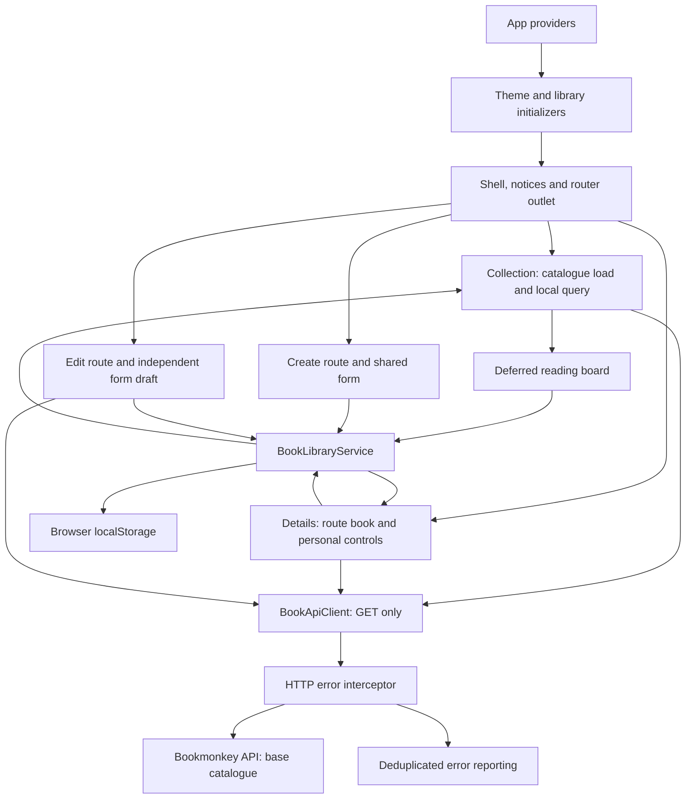

# Application architecture

BookMonkey is a browser-rendered Angular application for browsing, searching, sorting, filtering, and organizing a book collection, with browser-local book editing, personal lists, and a persistent light/dark preference. This document describes the implementation in this repository, including the difference between dependencies used by the application and packages declared for capabilities that are not currently implemented.

## Tech stack and dependencies

Versions below are the declarations in [package.json](./package.json). [package-lock.json](./package-lock.json) records the resolved dependency tree; a leading `^` denotes a version range rather than an exact pin.

### Application dependencies in use

| Dependency                                                                           | Declared version      | Role in this application                                                                                                                             |
| ------------------------------------------------------------------------------------ | --------------------- | ---------------------------------------------------------------------------------------------------------------------------------------------------- |
| `@angular/core`, `@angular/common`, `@angular/compiler`, `@angular/platform-browser` | `21.2.26`             | Components, dependency injection, common template directives, template compilation, browser bootstrap, and `HttpClient` from `@angular/common/http`. |
| `@angular/router`                                                                    | `21.2.26`             | Displays the book list and book details in the root router outlet and redirects unknown URLs to the home route.                                      |
| `@angular/forms`                                                                     | `21.2.26`             | Signal Forms for collection filters and validated independent creation/editing drafts. Single-action controls use native value/event bindings.       |
| `rxjs`                                                                               | `7.8.0`               | Supplies typed API and view-state streams, cancels obsolete searches and route requests, and coordinates retries.                                    |
| `zone.js`                                                                            | `0.15.0`              | Loaded as a polyfill; zone-based change detection is configured with event coalescing.                                                               |
| `@angular/material`, `@angular/cdk`                                                  | `^21.2.14`, `21.2.14` | Material snackbar support in `ToastService` and CDK drag/drop for the reading board. The book screen does not call the toast service.                |
| `tslib`                                                                              | `2.3.0`               | Runtime helpers for TypeScript compilation; `importHelpers` is enabled.                                                                              |

### Development and styling dependencies

| Dependency                            | Declared version      | Purpose                                                                                                                     |
| ------------------------------------- | --------------------- | --------------------------------------------------------------------------------------------------------------------------- |
| `typescript`                          | `5.9.2`               | Application language with strict type checking and an ES2022 target.                                                        |
| `@angular/cli`, `@angular/build`      | `21.2.30`             | CLI commands, application builds, and the development server.                                                               |
| `@angular/compiler-cli`               | `21.2.26`             | Angular compilation and template type checking.                                                                             |
| `tailwindcss`, `@tailwindcss/postcss` | `4.1.12`              | Utility classes for layout, responsive book cards, colors, and loading indicators.                                          |
| `postcss`                             | `8.5.6`               | Runs the Tailwind plugin configured in [.postcssrc.json](./.postcssrc.json).                                                |
| `prettier`                            | `3.6.2`               | Formatting configured in [.prettierrc](./.prettierrc), including Angular HTML parsing.                                      |
| `@playwright/test`                    | `^1.55.0`             | Browser test infrastructure for Chromium, Firefox, and WebKit, including book details tests with intercepted API responses. |
| `@types/node`, `@types/express`       | `^20.19.43`, `^5.0.1` | Type definitions for Node tooling and Express-related code.                                                                 |

### Additional declared dependencies

`@angular/animations` remains declared for the workshop but has no application provider or animation triggers.
Application transitions use CSS; the unused legacy animation provider has been removed.

| Dependency                                            | Declared version              | Current integration                                                                                            |
| ----------------------------------------------------- | ----------------------------- | -------------------------------------------------------------------------------------------------------------- |
| `@ngrx/signals`                                       | `21.1.1`                      | No Signal Store is defined or used in the current source.                                                      |
| `@angular-architects/ngrx-toolkit`                    | `^21.0.1`                     | No toolkit integration is present.                                                                             |
| `@tanstack/angular-query-experimental`                | `^5.85.5`                     | No query client provider or query hooks are used; HTTP subscriptions are handled directly by the component.    |
| `@angular/platform-server`, `@angular/ssr`, `express` | `21.2.26`, `21.2.30`, `5.1.0` | No server entry point or SSR build configuration is present. The configured application starts in the browser. |

## Structure and responsibilities

The application uses standalone components and application-level providers, with no application `NgModule`.
Routed pages own query/route state and compose small presentation components. HTTP, reporting, and theme effects have
separate owners.

| File or directory                                                                                                                                                                              | Responsibility                                                                                                                                               |
| ---------------------------------------------------------------------------------------------------------------------------------------------------------------------------------------------- | ------------------------------------------------------------------------------------------------------------------------------------------------------------ |
| [src/main.ts](src/main.ts)                                                                                                                                                                     | Bootstraps the app and reports bootstrap failures through the same deduplication function used at runtime.                                                   |
| [app.config.ts](src/app/app.config.ts)                                                                                                                                                         | Routing, API URL, HTTP error infrastructure, zone change detection, and explicit theme/library initializers.                                                 |
| [app.ts](src/app/app.ts), [app.html](src/app/app.html), [app.css](src/app/app.css)                                                                                                             | Root shell with the theme switch, unexpected-error notice, router outlet, and footer. The component class only injects services.                             |
| [app.routes.ts](src/app/app.routes.ts)                                                                                                                                                         | Lazy collection, recommendation, creation, details, and edit routes; `/books/new` precedes dynamic IDs and the wildcard redirect is last.                    |
| [book-list.component.ts](src/app/books/book-list.component.ts), [HTML](src/app/books/book-list.component.html)                                                                                 | Loads the full catalogue, combines browser-local state and debounced queries, and composes Gallery, Universe, and Reading list displays.                     |
| [book-details.component.ts](src/app/books/book-details.component.ts), [HTML](src/app/books/book-details.component.html)                                                                        | Loads a book by route ID, applies local edits, records successful views, and exposes saved/status controls.                                                  |
| [book-recommendation.component.ts](src/app/books/book-recommendation.component.ts), [HTML](src/app/books/book-recommendation.component.html), [selector](src/app/books/book-recommendation.ts) | Monthly spotlight route with catalogue states, pure full-collection selection, shared cover/personal controls, and details navigation.                       |
| [book-item.component.ts](src/app/books/book-item.component.ts)                                                                                                                                 | Presents a book, links to details/editing, and emits saved/status actions through shared personal controls.                                                  |
| [book-cover.component.ts](src/app/books/book-cover.component.ts)                                                                                                                               | Shared card/detail cover rendering, missing/broken-image fallback, and local failure reset when the source changes.                                          |
| [book-api-client.service.ts](src/app/books/book-api-client.service.ts), [book-api.config.ts](src/app/books/book-api.config.ts)                                                                 | Read-only HTTP access to the full base catalogue and individual books using an injected API URL and expected-404 context.                                    |
| [book.ts](src/app/books/book.ts), [request-state.ts](src/app/books/request-state.ts)                                                                                                           | Shared book model and discriminated loading/ready/error state; details extend the union with not-found.                                                      |
| [book-library.service.ts](src/app/books/book-library.service.ts), [book-library.ts](src/app/books/book-library.ts)                                                                             | Startup validation and compatible loading of local books, edits, saved/status/recent state, and board order; command-based persistence with failure notices. |
| [book-collection.ts](src/app/books/book-collection.ts)                                                                                                                                         | Pure projection: merge created records, apply edits, match/filter/view/sort the full collection, then clamp and slice the gallery page.                      |
| [book-pagination.component.ts](src/app/books/book-pagination.component.ts)                                                                                                                     | Previous/Next controls, page status, and native numbered-page selection.                                                                                     |
| [book-reading-board.component.ts](src/app/books/book-reading-board.component.ts), [HTML](src/app/books/book-reading-board.component.html)                                                      | Deferred board presentation, CDK drag/drop, native status controls, and ID-based move events; library service owns persisted state.                          |
| [book-filters.component.ts](src/app/books/book-filters.component.ts), [HTML](src/app/books/book-filters.component.html)                                                                        | Controlled sorting/filter UI that emits changes and reports invalid page ranges.                                                                             |
| [book-library-controls.component.ts](src/app/books/book-library-controls.component.ts)                                                                                                         | Reusable save/unsave and reading-status controls for cards and details.                                                                                      |
| [book-edit.component.ts](src/app/books/book-edit.component.ts), [HTML](src/app/books/book-edit.component.html)                                                                                 | Direct-linkable editor route; loads the original book, supplies local overrides, and saves changes through the library service.                              |
| [book-create.component.ts](src/app/books/book-create.component.ts)                                                                                                                             | Browser-local creation through the shared validated form, followed by navigation to the new book's details.                                                  |
| [book-edit-form.component.ts](src/app/books/book-edit-form.component.ts), [HTML](src/app/books/book-edit-form.component.html)                                                                  | Shared independent creation/edit draft, title/page validation, configurable submit label/cancel route, and typed save output.                                |
| [theme.service.ts](src/app/shared/theme.service.ts)                                                                                                                                            | Explicit, idempotent startup initialization; signal-backed theme state; document-root and storage updates on commands.                                       |
| [http-error.interceptor.ts](src/app/shared/http-error.interceptor.ts)                                                                                                                          | Reports unexpected HTTP failures and rethrows the original error; suppresses reporting of explicitly expected 404 responses.                                 |
| [global-error-handler.ts](src/app/shared/global-error-handler.ts), [error-reporter.service.ts](src/app/shared/error-reporter.service.ts)                                                       | Reports unhandled errors, deduplicates repeated error objects, and exposes a dismissible notice for unexpected runtime failures.                             |
| [loading-indicator.component.ts](src/app/shared/loading-indicator.component.ts), [state-message.component.ts](src/app/shared/state-message.component.ts)                                       | Shared request feedback with status/alert semantics, reduced-motion loading, projected headings, and page-owned action content.                              |
| [toast.service.ts](src/app/shared/toast.service.ts)                                                                                                                                            | Existing Material snackbar wrapper, available for explicit notifications; request errors currently use inline page feedback.                                 |
| [styles.css](src/styles.css), [material-theme.scss](src/material-theme.scss)                                                                                                                   | Tailwind import, semantic light/dark palettes, common interaction styles, native color scheme, and matching snackbar color overrides.                        |
| [index.html](src/index.html), [public/](public/)                                                                                                                                               | Browser HTML shell, fonts/icon stylesheets, and static assets.                                                                                               |

The root shell and larger routed book pages use separate HTML files. Small components keep inline templates.
Templates use `@if`, `@switch`, and `@for` with stable book IDs. All production components use `OnPush` and the default
standalone behavior. Component contracts use `input()`/`output()`; local UI state uses signals and computed values.
Pages subscribe to composed request state once through the async pipe, retaining RxJS cancellation and query timing.

The earlier modernization followed Angular CLI 20.2.0 MCP server's `get_best_practices` guide, retrieved directly
over stdio. [Cursor MCP configuration](.cursor/mcp.json) exposes the CLI server for editor sessions. No Angular upgrade
or dependency changes were needed. The production build's initial bundle decreased from 445.74 kB to 307.44 kB through
lazy component routes and removal of the unused animation provider. Route-specific chunks load when needed; these
figures describe the initial build budget rather than the total bytes fetched during a visit.

The subsequent Angular 21 upgrade uses the official [ng update process](https://angular.dev/cli/update), aligning the
local CLI/build at 21.2.30, framework/compiler at 21.2.26, Material/CDK at 21.2.14, and required NgRx/toolkit peers.
Required migrations completed without source changes. Node 24, TypeScript 5.9, RxJS 7.8, and the explicit Zone.js
configuration are retained. `npm run ng -- version` reports the workspace CLI; the Cursor CLI MCP entry pins major 21.
At that upgrade, the production build, custom MCP build/generation checks, and all 57 application Chromium cases passed
on the new server. The subsequent Signal Forms migration retains those cases and adds two form characterizations.

The standalone [book review example](src/components/book-review-example.component.ts) is an intentionally flawed fixture
for pull-request code-review exercises. It lives under the requested `src/components/` path and is not part of the routed
application. Its defects are deliberate review material rather than production conventions to copy.

## Runtime architecture and data flow



### Catalogue, query, and personal views

The API supplies the base catalogue (250 books in the current local dataset). The list loads the complete array through
`getBooks()`, then combines that request state with the browser library and a typed query. Created books are prepended
and local metadata edits applied before matching or sorting. This makes titles/authors/publishers/page counts consistent across details,
search, filters, and personal views.

- Search trims whitespace and ignores case. One normalized character matches only the title's beginning; two or more
  characters match literal text anywhere in the title. Author, subtitle, or description matches alone do not qualify.
- Nonempty typing waits 300 ms; a new query replaces an obsolete timer. Clear and filter/sort/view changes run immediately.
  Local queries do not emit HTTP requests. Retrying a catalogue error starts a fresh GET.
- Author and publisher filters match case-insensitive text. Minimum and maximum pages are inclusive and combine with the
  title search and reading-status filter. Invalid minimum/maximum order has an explicit inline message.
- Sorting supports title or author ascending/descending. Default order puts new local books first, preserving the API
  collection order afterward; in the recent view, the most recent unique visit comes first.
- All books, Read later, and Recently viewed select the collection membership. Saved/status changes update these views
  immediately through library state.
- Matching and ordering operate on the whole merged collection before pagination. Gallery pages contain ten books by
  default, with Previous/Next and native numbered-page selection. Query/filter/sort/view changes reset to page one;
  shrinking membership clamps the visible page. Page changes do not request the catalogue again. Result count describes
  all matches, not only visible cards. This replaces the former expanding Show more behavior.
- Request state remains a discriminated union: loading, ready with data, or error with a message. Empty results are a
  successful state. The async pipe owns the list subscription and cancels pending load/timer work on destruction.

The catalogue is reloaded when the collection page is recreated; no query-cache dependency has been added. Loading the
whole dataset fits the current workshop catalogue. A substantially larger collection would need a backend contract that
can combine original records and per-user edits before server-side filtering/pagination.

### Monthly reading recommendation

The home header includes a keyboard-accessible recommendation tile with a custom open-book and sparkle SVG, adapted to the semantic blue
accent and light/dark surfaces. It links to lazy `/recommendation`; the shortcut itself needs no extra HTTP request.
The feature page loads the catalogue on entry/retry and combines it with browser library state through one async-pipe
subscription. Loading, recoverable error, and successful-empty states reuse shared feedback components.

The pure selector reuses the full collection projection, including created records and local edits, with no gallery
filters or page limit. It sorts stable IDs and selects `(year * 12 + zeroBasedMonth) % count`, using the browser's local
calendar. With the same collection and month, API reordering and personal-status changes do not change the pick; the
next month advances the selection. Changing collection membership can change the selected book. No selection record,
timer, external recommendation service, or API mutation is added.

The spotlight presents actual cover/author/title/subtitle/publisher/pages/price/description data. It reuses the cover
fallback, saved/status controls, and the selected book's details route, including local IDs. The layout stacks at narrow
widths. The screenshot reference supplies composition and icon inspiration; unavailable rating/format/checkout data is
not fabricated.

### Gallery and interactive Universe

The home page has Gallery, Universe, and Reading list display tabs, independent of the All books/Read later/Recently viewed collection
selection. Switching display keeps the same search, filters, sorting, membership, and catalogue subscription. The gallery
uses numbered pages. `CollectionPage.matchingBooks` exposes every filtered/sorted match to the map and reading board,
including books beyond the current ten cards; switching tabs does not start another catalogue request.

[BookUniverseComponent](src/app/books/book-universe.component.ts) owns only map presentation, selection, and camera
interaction. Its [HTML](src/app/books/book-universe.component.html) and [CSS](src/app/books/book-universe.component.css)
render a perspective-projected 3D galaxy, native controls, and a shared-cover preview linked to the existing details
route. The pure [layout and projection functions](src/app/books/book-universe-layout.ts) distribute books in world-space
constellations with X/Y/Z coordinates, rotate them by camera yaw/pitch, and apply a perspective divide to positions and
star sizes. Publisher/author grouping uses displayed metadata including local edits. Query order remains stable
for keyboard navigation and the native selector. Rendering uses SVG without a WebGL library, dependency, or API write.

The camera supports pointer orbit/capture, native rotate/tilt buttons, arrow-key orbit, Shift-drag/Shift-arrow panning,
bounded zoom, Ctrl/Meta-wheel zoom, and Fit all. Fit all resets orientation, zoom, and pan. A native book selection centers
that star at 200% zoom. Each
star has an accessible name and selected state; one star participates in tab order, with arrow/Home/End navigation
between stars. The native selector provides an alternative to small visual targets on narrow screens. Star labels and
decorative glows do not intercept the interactive hit area. New matching data or grouping resets the overview and keeps
the selected book where still present. Map state and display selection are local to the page, not persisted preferences.

The map's required book input is a signal. `linkedSignal` preserves a selected ID while it remains in the matches,
chooses the first match when necessary, and resets the writable camera when matching books or grouping change. The
shared cover uses the same source-linked pattern to clear failure state for a new image URL.

Loading, retry/error, and empty feedback remain owned by the collection page in either display. The map adapts its
preview below the canvas on narrow screens; the star field intentionally keeps its dark astronomical palette in both
application themes. Outside the chart, controls and preview use the existing semantic theme styles.

The galaxy layers a luminous core, projected orbital paths, 320 deterministic spiral-dust particles, 150 distant stars,
and grouped book stars. Dense catalogues suppress unselected group labels; stronger rings identify selection/hover/focus.
CSS ambient twinkling and core glow stop under reduced-motion preference. Camera movement is user-controlled and has no
animation loop, timers, or global listeners to tear down. The preview gives the shared cover a CSS 3D spine/pages effect.
Common layout uses theme utilities; scene-specific styles remain within the existing 4 kB component-style budget.

### Browser-local library and editing

The user explicitly chose to store all changes in this browser. `BookLibraryService.initialize()` is called through
`provideAppInitializer`; constructors only inject dependencies or assemble state. The service reads
`bookmonkey-library-v1`, validates its shape, and exposes state through a read-only observable.

Stored state contains saved book IDs, reading statuses keyed by ID, unique recent IDs in visit order, metadata overrides,
`createdBooks`, and `readingOrder` arrays for the three statuses. The existing v1 storage key is retained: absent new
fields default to empty records, and old statuses populate their column order. Invalid/duplicate order entries are
discarded while valid existing saved IDs, edits, and history survive. Commands update state and attempt to persist it. Storage read/parse/write
failures leave the app usable and display a notice; unsuccessful writes are identified as available for this visit only.
There is no account, cross-device synchronization, API mutation, or automatic cross-tab state synchronization.

Cards and details share save/unsave and status controls. Status can be unset or one of Want to read, Reading, and Finished.
Successful detail loads record a visit without duplicating the same ID; revisiting moves it to the front. The API still
supplies the base records, so browser-local changes do not imply offline catalogue availability.

`/books/new` shares the existing editor form and saves a new `local-` UUID record with a stable ID independent of ISBN.
It then opens details. Creation and editing share validation and field presentation; action label and Cancel target
are focused inputs. Details/edit routes look up created records in the initialized library before using the API, so
direct local-book links and reloads do not request that ID from the server. No POST/PUT/PATCH requests are introduced.

`/books/:id/edit` loads a book and copies its merged metadata into an independent form draft. Save stores a local
override and returns to details; Cancel leaves stored data unchanged. Title must be nonblank and page count a positive
whole number. Editable fields are title, subtitle, author, publisher, ISBN, page count, formatted price, cover URL, and
description. Book ID and user ID are not edited; changing the displayed ISBN does not change routing identity.

The editor and collection filters use typed signal models and `form()` field trees from `@angular/forms/signals`.
`ngOnChanges` resets field state with a copied input, preserving an independent draft. Editor schema rules enforce a
required nonblank title and a required positive whole-number page count; touched/invalid signals control feedback.
`FormRoot` prevents native navigation, validates/touches the form, and guards duplicate submissions before emitting
trimmed metadata. `FormField` owns native names and schema-derived required/min attributes. Signal Forms are
[experimental in Angular 21](https://v21.angular.dev/api/forms/signals/form); this implementation uses the installed
21.2.26 API, including `FormRoot`.

Filter schemas own numeric minimums and the cross-field range error. Label-level native input/change events run after
the field binding updates and emit a copied model; programmatic input synchronization does not emit. Reset clears field
state and emits once. No form subscription/effect bridge is needed. Empty numeric fields remain `null`. Search and native
reading-status/map selectors retain direct value/event bindings. The unrouted review example also replaces its template
form binding with a Signal Form; its other review-exercise behavior remains intact. No legacy form imports or bindings
remain in application source.

The API URL is injected through `BOOK_API_URL`, defaulting to `http://localhost:4730/books`. Single-book IDs are
URL-encoded, and trailing slashes are normalized. All catalogue requests are GETs. Direct detail/editor links and refreshes
resolve local created records or load API originals, then reapply local overrides. Descriptions remain plain text with preserved line breaks.

### Reading-list board

The Reading list tab presents Want to read, Currently reading, and Read, mapped to the existing `want-to-read`, `reading`,
and `finished` values. Cards/details and the board use the same library statuses. Search, filters, and personal views
limit visible cards and the add-book selector; gallery pagination does not. Board order is manual, so its sort control
is hidden. Adding enters Want to read, removing clears only reading status, and native status menus provide a keyboard
alternative to dragging.

CDK drop events emit a target status and the next visible card's stable ID. The library service removes the moved ID
from all column orders and inserts it relative to that anchor, updating status and order atomically. Hidden filtered
cards retain their order. Column moves and within-column reordering survive reload. The responsive columns stack on
small screens; controls use the shared themes, live announcements, and reduced-motion styles.

The standalone board and its CDK dependencies load through `@defer` inside the selected-tab branch, with loading/error
feedback, following [Angular's deferred-view guidance](https://angular.dev/guide/templates/defer). The verified build
separates a 69.77 kB board chunk from the 42.38 kB collection chunk; the initial bundle is 340.04 kB with the monthly
recommendation feature. That route has a separate 7.06 kB chunk. These sizes describe this build, not the earlier
modernization baseline or total visit bytes.

### Error handling and presentation

The functional HTTP interceptor reports failures and rethrows the original error. Single-book requests mark HTTP 404 as
expected through context, so details and editors render a local not-found state without a global report. Other HTTP
failures are reported once and recovered into page-owned error/retry state.

Browser global listeners forward unhandled errors to `GlobalErrorHandler`. The shared reporter deduplicates error objects
by identity, logs context to the console, and exposes one dismissible shell notice for unexpected runtime failures.
HTTP errors do not also create that notice or a toast. A shared bootstrap fallback remains available before the UI exists.
Storage warnings are expected local-state feedback, separate from unexpected runtime reports.

Large pages and forms use external HTML; small presentation components use inline templates. Shared loading/state/cover
components retain accessible announcements and cover fallbacks. Page templates own heading levels and actions. Stable
book-ID tracking preserves card identity while local metadata and personal state update.

### Theme and interaction styles

`ThemeService.initialize()` still supplies the saved/system light/dark choice before the shell renders. Only explicit
toggles persist the choice; blocked storage does not disable switching. The document-root `dark` class and native
`color-scheme` remain centralized.

Semantic Tailwind utilities map to the shared light/dark CSS palette. `button-primary`, `button-secondary`,
`form-control`, `text-link`, and `focus-ring` share interaction styling. Pressed personal-view/save controls have a
visible selected state. Snackbar colors use the same palette; layout stays local to templates.

## Build and configuration

[angular.json](./angular.json) defines a single application named `angular-workshop-modern`. Its build uses `@angular/build:application` with `src/main.ts` as the browser entry, `zone.js` as a polyfill, `public/` as the asset source, and both global style files.

- Production is the default build configuration and enables output hashing. Bundle budgets warn at 500 kB and fail at 1 MB for the initial bundle; component styles warn at 4 kB and fail at 8 kB.
- The development server defaults to the development configuration, with optimization disabled and source maps enabled.
- [tsconfig.json](./tsconfig.json) enables TypeScript strictness, strict Angular templates and injection checks, isolated modules, and an ES2022 target with preserved module syntax.
- [tsconfig.app.json](./tsconfig.app.json) includes application TypeScript and excludes `*.spec.ts`; [tsconfig.spec.json](./tsconfig.spec.json) declares Jasmine test types.
- Tailwind is imported from the global CSS file and processed through PostCSS. Semantic CSS variables supply the light/dark palettes; the SCSS file aligns Material snackbar colors with those tokens rather than defining a full Material theme.

## Development commands and tests

### GitHub automation

The [workflow guide](.github/README.md) describes build/test/Pages deployment, OpenAI issue analysis, PR review, issue
implementation, and CI auto-fix. Codex reads issue/PR snapshots captured through the GitHub API and uses repository
`AGENTS.md` guidance with explicit prompt files. Analysis/review is read-only; separate jobs publish the resulting
comments. Implementation and auto-fix produce checked working-tree patches which a shared reusable workflow publishes
as draft PRs on new branches. Publication verifies the base commit and never directly changes the default branch.

The build workflow runs the six application Chromium suites and publishes the Angular browser artifact when the default
branch is deployed to Pages, with the Pages base path and an SPA fallback. On default-branch runs, Configure Pages uses
the `PAGES_SETUP_TOKEN` repository secret and automatic enablement; other GitHub operations use the automatic job token.
Repository secrets, Pages availability, and permission to create pull requests are repository settings, not app
configuration. Frontend deployment does not provide
the separate book API. Browser fixtures still establish local application behavior rather than deployed integration.

Build, auto-fix, and issue implementation all validate using `npm run build` and the same application browser suites.
Node.js 24 is selected through [.node-version](.node-version) and restored after Codex before independent validation.
Dependency installation explicitly includes development packages; browser binaries are refreshed after reinstalling a
changed lockfile. The [Pages helper](.github/scripts/prepare-pages.cjs) prepares the generated base URL and route fallback
after checks, with focused [tests](.github/scripts/prepare-pages.test.cjs). Pages preparation does not change the shared
build command or application source.

### Local development and checks

Run commands from the repository root. The API and frontend require separate processes.

`npm run eval.gpt` starts the separate code-generation playground through
the Git submodule registered in [.gitmodules](.gitmodules). Its URL matches the playground's existing `origin`, and
the parent repository pins its commit. Initialize the submodule before installing its evaluator dependencies.
[tools/eval.mjs](tools/eval.mjs) supplies the evaluation launcher.
The launcher uses the playground's working directory, selects `gpt-5.1-no-thinking`
for the goal-tracker prompt, forwards extra arguments, and normalizes absolute Windows ES module imports
for scorer 0.0.69. The playground installs Angular template dependencies during evaluation. Live runs require
`OPENAI_API_KEY` for generation and `GEMINI_API_KEY` for the existing default ratings/summary. The scorer maps the GPT
alias to `gpt-5.1` with reasoning effort `none`. `npm run eval.opus` remains a compatibility alias, and both root and
playground entrypoints use the same launcher. Historical reports retain their original model selection. Evaluation is separate
from the BookMonkey build and regression suites; no live evaluation result is implied by a launcher check.

On Windows, the evaluation launcher redirects only scorer's filesystem helper import to
[scorer-windows-fs.mjs](tools/scorer-windows-fs.mjs). It links dependency directories using junctions while preserving
other filesystem operations. This avoids workspace setup failures caused by ordinary directory symlink permissions.
Focused [filesystem tests](tools/scorer-windows-fs.test.mjs) verify dependency access and preservation of source files.
An evaluation with no results and zero maximum points has no defined score percentage; its completion metadata records
the failed prompts. Existing failed reports are retained, and real scores require another completed evaluation.

`npm run report` uses [tools/report.mjs](tools/report.mjs) to launch the playground's report command, retaining its
working directory so the viewer finds the saved `.web-codegen-scorer/reports` files. The viewer defaults to port 4201,
separate from BookMonkey's port 4200. An explicit override such as `npm run report -- --port=4300` is forwarded once.

The custom [Angular component MCP server](tools/angular-mcp/index.ts) is separate from the Angular CLI's built-in MCP
server configured in `.cursor/mcp.json`. Build it with `npm run build.angular-mcp` and start it with
`node dist/angular-mcp/index.js`. Its `generate_component` tool invokes the installed CLI with separate arguments,
supports paths with or without the `src/app` prefix, and returns tool errors for failed generation. Diagnostic logs
use stderr so stdout remains an MCP protocol channel. Register it separately in `~/.cursor/mcp.json` with the absolute
compiled-server path; the project MCP configuration retains the Angular CLI's built-in server.
VS Code's Copilot harness reads the custom server from the workspace [.mcp.json](.mcp.json), using the native
`mcpServers` schema. That entry contains this checkout's absolute compiled-server path; adjust it for another location.

| Command                | Effect                                                                                                                                                          |
| ---------------------- | --------------------------------------------------------------------------------------------------------------------------------------------------------------- |
| `npm install`          | Installs the frontend dependencies.                                                                                                                             |
| `npx bookmonkey-api`   | Starts the separately distributed fake-data API at `http://localhost:4730`, as described in [README.md](./README.md). This package is not a project dependency. |
| `npm start`            | Runs `ng serve`; the local frontend is expected at `http://localhost:4200`.                                                                                     |
| `npm run build`        | Builds the production application.                                                                                                                              |
| `npm run watch`        | Rebuilds continuously with the development configuration.                                                                                                       |
| `npm test`             | Invokes the configured Angular Karma target; see the current testing status below.                                                                              |
| `npx playwright test`  | Runs the tests selected by [playwright.config.ts](./playwright.config.ts).                                                                                      |
| `npm run format.write` | Formats supported files under `src/`; the script does not include Markdown files at the repository root.                                                        |

The browser suites share [book-fixtures.ts](tests/book-fixtures.ts), which supplies books, intercepted read-only API/cover
responses, and captured application error reports. They do not require a running API.

- [book-details.spec.ts](tests/book-details.spec.ts): navigation, fields, direct links/reloads, loading, retries, missing
  books/covers, and narrow layouts.
- [book-list.spec.ts](tests/book-list.spec.ts): actual one-letter/longer/literal title matching, author-only exclusion,
  both sort fields/directions, combined inclusive filters, range validation, debouncing/clear without search HTTP calls,
  full-catalogue matching before pagination, page bounds/resets/clamping, teardown, and catalogue error recovery.
- [library.spec.ts](tests/library.spec.ts): saved/status persistence and removal, recent order/deduplication, local edits
  and unchanged IDs, edited-field matching/filtering, no API writes, browser-context isolation, cancel, validation,
  editor refresh/not-found, local creation/reload/equal-ISBN identities, storage failure feedback, and mobile/dark layouts.
  Board cases cover legacy status migration, native controls, real CDK pointer dragging, persistent card order, and 320px
  layouts in both themes.
- [error-handling.spec.ts](tests/error-handling.spec.ts): local 404 outcomes, HTTP/network errors and retries, and
  deduplicated runtime reporting.
- [theme.spec.ts](tests/theme.spec.ts): keyboard switching, actual color changes, preference precedence, navigation/reload,
  system defaults, narrow screens, and blocked storage.
- [universe.spec.ts](tests/universe.spec.ts): display tabs and keyboard focus, preserved query/personal views, 250 matching
  stars before gallery limits, no extra catalogue requests, preview/details navigation, zoom/drag/Fit, keyboard star
  navigation, grouping, cover recovery and selection/camera updates, loading/error/retry/empty feedback, and 320px layouts
  in both themes. Additional 3D cases check perspective size/position changes, pointer/keyboard orbit, native tilt,
  complete camera reset, grouping/selection, and reduced-motion behavior.
- [example.spec.ts](tests/example.spec.ts) and [tests-examples/](tests-examples/) remain external demonstration scaffolding.
  Karma still has no source specs or directly declared Karma/Jasmine dependencies.

Playwright starts or reuses the frontend at port 4200. Install the matching browser for the project's Playwright version.
A portable selected-suite command is:

```sh
npx playwright test tests/book-details.spec.ts tests/book-list.spec.ts tests/library.spec.ts tests/error-handling.spec.ts tests/theme.spec.ts tests/universe.spec.ts --project=chromium
```

The unused NgRx, toolkit, query, and server packages listed above remain declared workshop options. This refactoring uses
the existing Angular/RxJS stack and retains those packages to preserve the workshop setup; none has been integrated into
the runtime. [REFACTORING.md](REFACTORING.md) records the original findings and implementation status.
